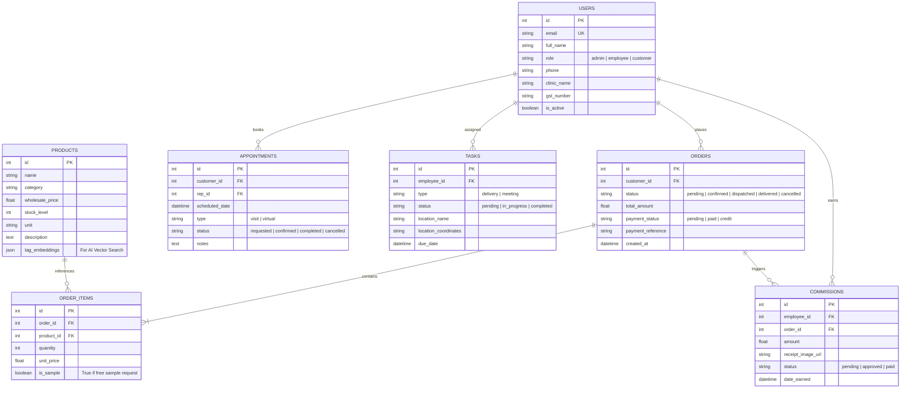

# EkanaVet Enterprise Platform — Master Context & Planning Document

> **Document Purpose:** This document provides the complete technical architecture, current implementation state, data schemas, API contracts, design language, and phased roadmap for the **EkanaVet Enterprise Platform**. Use this file as the ground-truth context prompt to generate future development plans, sprint tasks, and architectural decisions.

---

## 1. Executive Summary & Vision

* **Business Identity:** EkanaVet is a licensed B2B veterinary pharmaceutical and animal wellness wholesale distributor.
* **Core Value Proposition:** Streamlines wholesale veterinary medicine procurement for veterinary clinics, retailers, and dairy/poultry farms, paired with field force logistics (Medical Representatives & Delivery Agents) and AI-assisted veterinary advisory.
* **Primary Stakeholder Groups:**
  1. **B2B Customers (Clinics, Retailers, Large Farms):** Bulk ordering, credit/payment tracking, sample requests, and meeting scheduling with Medical Representatives (MRs).
  2. **Field Staff / Employees:**
     - **Medical Reps (MRs):** Doctor visit schedules, demo appointments, clinic relationships, commission tracking.
     - **Delivery Agents:** Order fulfillment routes, delivery sign-offs, fuel/travel expense receipt filing.
  3. **Platform Administrators:** Inventory management, user role approvals, order dispatching, task assignments, sales analytics.
  4. **Public / End-Users:** Product discovery, local clinic locator, and AI-powered symptom/dosage advisor.

---

## 2. Technology Stack & Environment

### Frontend
* **Core Framework:** React 19 (`react`, `react-dom`)
* **Build Tool:** Vite 7 (ES Modules)
* **Styling:** Tailwind CSS 3.4 + PostCSS + Autoprefixer
* **State Management:**
  * **Global Cart:** Redux Toolkit (`@reduxjs/toolkit`, `react-redux`)
  * **Authentication & Session:** React Context (`AuthContext.jsx`) stored in `localStorage`
* **Routing:** React Router v7 (`react-router-dom`)
* **Icons:** React Icons (`react-icons/fa`)
* **HTTP Client:** Axios (`baseURL: http://localhost:8000/api/v1`)
* **Dev Server URL:** `http://localhost:5173`

### Backend
* **Core Framework:** FastAPI 0.137+
* **ASGI Server:** Uvicorn (StatReload)
* **Language & Runtime:** Python 3.11.9 (Dedicated virtual environment at `d:\chacha\.venv`)
* **ORM:** SQLAlchemy 2.0
* **Data Validation & Settings:** Pydantic 2.13, Pydantic Settings (`pydantic-settings`), `email-validator`
* **Security & Auth:** OAuth2 Password Bearer, JWT (`python-jose`), Passlib with `bcrypt < 4.0.0`
* **Primary Database (Current):** SQLite (`backend/sql_app.db`)
* **Primary Database (Target Production):** PostgreSQL (`psycopg2-binary`)
* **Server URL:** `http://127.0.0.1:8000` (Docs: `http://127.0.0.1:8000/docs`)

---

## 3. Architecture & Project Layout

```text
d:\chacha\
├── .venv/                              # Python 3.11 virtual environment
├── workplan.pdf                        # Original strategic design blueprint
└── ekana-vet-platform/
    ├── requirements.txt                # Backend dependencies
    ├── backend/
    │   ├── sql_app.db                  # Local SQLite database
    │   ├── data/
    │   │   └── products_initial.json   # Seed data for initial 6 products
    │   └── app/
    │       ├── main.py                 # FastAPI application root, CORS & router mounting
    │       ├── initial_data.py         # DB seeding script (products & default admin)
    │       ├── core/
    │       │   ├── config.py           # Pydantic Settings (SECRET_KEY, DB URL, Token expiry)
    │       │   └── security.py         # JWT creation, Bcrypt password hashing & verification
    │       ├── db/
    │       │   ├── base.py             # Declarative Base
    │       │   └── session.py          # SQLAlchemy Engine & SessionLocal maker
    │       ├── models/
    │       │   ├── user.py             # User ORM model & UserRole enum
    │       │   └── product.py          # Product ORM model
    │       ├── schemas/
    │       │   ├── user.py             # UserCreate, UserResponse schemas
    │       │   ├── product.py          # ProductCreate, ProductResponse schemas
    │       │   └── token.py            # Token & TokenData schemas
    │       ├── api/
    │       │   ├── deps.py             # DB session & get_current_user dependencies
    │       │   └── v1/
    │       │       ├── api.py          # API v1 router aggregator
    │       │       └── endpoints/
    │       │           ├── login.py    # OAuth2 login & local admin verification
    │       │           ├── users.py    # User creation and /me profile
    │       │           └── products.py # Catalog retrieval and creation
    │       └── services/               # Placeholder for business logic services
    └── frontend/
        ├── package.json                # NPM configuration
        ├── vite.config.js              # Vite bundler settings
        ├── tailwind.config.js          # Brand theme colors and fonts
        └── src/
            ├── App.jsx                 # Route tree & public/private layouts
            ├── api/
            │   └── axios.js            # Configured Axios instance with auth interceptor
            ├── context/
            │   └── AuthContext.jsx     # Auth state, login, register, logout functions
            ├── store/
            │   ├── store.js            # Redux store config
            │   └── cartSlice.js        # Cart items, quantity, total price reducer
            ├── components/
            │   ├── Cart.jsx            # Cart slide-over drawer
            │   ├── ProductGrid.jsx     # Product cards and add-to-cart actions
            │   ├── dashboard/          # StatCards, Sidebar widgets
            │   └── layout/
            │       ├── DashboardLayout.jsx      # Client / Employee sidebar layout
            │       └── AdminDashboardLayout.jsx # Dark-themed Admin management layout
            └── pages/
                ├── HomePage.jsx        # Landing page with hero & value props
                ├── ShopPage.jsx        # Public product shop
                ├── ServicesPage.jsx    # Overview of veterinary wholesale services
                ├── LoginPage.jsx       # Customer / Employee login
                ├── AdminLoginPage.jsx  # Dedicated admin portal login
                ├── RegisterPage.jsx    # B2B customer onboarding
                ├── MarketPage.jsx      # Authenticated B2B marketplace
                ├── TasksPage.jsx       # Field MR / Delivery dashboard
                ├── AiVetPage.jsx       # Interactive AI symptom checker
                └── AdminOverviewPage.jsx # Admin metrics and activity overview
```

---

## 4. Current Implementation State

### What is Fully Functional:
1. **Authentication & Authorization Engine:**
   - JWT tokens generated with 8-day expiration.
   - User roles defined: `ADMIN`, `EMPLOYEE`, `CUSTOMER`.
   - Admin restriction: Only IP addresses matching `127.0.0.1`, `localhost`, or `::1` can authenticate as Admin.
   - Default seeded Admin: `admin@ekanavet.com` / `admin123`.
2. **Product Catalog Backend:**
   - 6 initial products seeded in SQLite database:
     * Cattle Booster Plus (Supplements, ₹450)
     * CanineVax 5-in-1 (Vaccines, ₹1,200)
     * Feline Dewormer Tabs (Medicines, ₹250)
     * Poultry Growth Mix (Feed, ₹850)
     * Equine Joint Flex (Supplements, ₹1,500)
     * Antibiotic Spray (Topical, ₹150)
   - API endpoints for `GET /api/v1/products/` and `POST /api/v1/products/`.
3. **Frontend Presentation & Shell:**
   - Responsive UI with Emerald/Forest Green medical branding.
   - Client and Admin login pages connected to backend `/api/v1/login/access-token`.
   - Registration page connected to `/api/v1/users/`.
   - Redux shopping cart with addition/removal, badge counters, and subtotal calculation.
   - Admin dashboard layout and protected route wrappers.

### What is Mocked / Pending Real Implementation:
1. **Product Grid Live Hookup:** `ProductGrid.jsx` currently falls back to hardcoded mock products because the `fetch` block is commented out.
2. **Orders & Checkout:** Cart checkout currently calls browser `alert()`. Needs database models (`Order`, `OrderItem`), payment gateway (Razorpay/Stripe), or purchase order invoicing.
3. **Sample Request Workflow:** Workplan requires a distinct "Request Sample" workflow separate from regular cart orders, with quantity limits per customer to prevent abuse.
4. **Logistics & Tasks:** `TasksPage.jsx` has static dummy tasks (deliveries and meetings). Needs `Task` model, admin assignment workflow, and status updating ("Mark Done").
5. **Expense & Receipt Filing:** Front-end has button, but needs S3/local file storage upload and OCR/receipt record keeping.
6. **AI Assistant (`AiVetPage.jsx`):** Front-end is a UI placeholder. Requires LLM integration (Gemini or OpenAI API) + RAG retrieval over product specifications.
7. **Nearby Clinic Locator:** Needs Google Maps Places API integration.

---

## 5. Database Schema & Data Models

### Existing Tables

#### `users`
| Column | Type | Constraints | Description |
| :--- | :--- | :--- | :--- |
| `id` | Integer | PK, Index | User identifier |
| `email` | String | Unique, Index, Not Null | Login email |
| `full_name` | String | Nullable | Full name |
| `hashed_password` | String | Not Null | Bcrypt password hash |
| `is_active` | Boolean | Default True | Account status |
| `role` | Enum | `admin`, `employee`, `customer` | Role-based authorization |

#### `products`
| Column | Type | Constraints | Description |
| :--- | :--- | :--- | :--- |
| `id` | Integer | PK, Index | Product identifier |
| `name` | String | Index, Not Null | Commercial medicine/product name |
| `category` | String | Index | Category (Vaccines, Supplements, etc.) |
| `wholesale_price` | Float | Not Null | Bulk B2B price in INR (₹) |
| `stock_level` | Integer | Default 0 | Available inventory |
| `description` | Text | Nullable | Medical usage, dosage, specs |

---

### Target Schema for Future Phases (Per Blueprint)



---

## 6. API Specifications (Current & Target)

### Implemented Endpoints
* `POST /api/v1/login/access-token`: Form data (`username`, `password`). Returns `{ access_token, token_type }`.
* `POST /api/v1/users/`: Body `{ email, password, full_name, role }`. Returns created user.
* `GET /api/v1/users/me`: Requires Bearer token. Returns current authenticated user profile.
* `GET /api/v1/products/`: Returns list of products.
* `POST /api/v1/products/`: Admin/Staff product creation.
* `GET /health`: System health monitor (`{"status": "healthy"}`).

### Target Endpoints for Future Phases
* **Orders:**
  * `POST /api/v1/orders/`: Submit cart items to create a pending order.
  * `GET /api/v1/orders/my-orders`: Customer order history.
  * `GET /api/v1/orders/`: Admin order management.
  * `PATCH /api/v1/orders/{id}/status`: Dispatch / Mark Delivered.
* **Sample Requests:**
  * `POST /api/v1/samples/request`: Check limits (e.g. max 2 samples/quarter) and create sample order.
* **Appointments & Rep Meetings:**
  * `POST /api/v1/appointments/book`: Schedule doctor visit with assigned MR.
  * `GET /api/v1/appointments/my-schedule`: MR calendar view.
* **Logistics & Tasks:**
  * `GET /api/v1/tasks/today`: Assigned delivery/meeting route for current employee.
  * `POST /api/v1/tasks/{id}/complete`: Mark task complete with optional coordinates or signature.
* **Expenses & Receipts:**
  * `POST /api/v1/expenses/upload-receipt`: Upload fuel/travel image, log reimbursement.
* **AI Veterinary Assistant:**
  * `POST /api/v1/ai/consult`: Accept animal type + symptoms; run RAG over `products` table and veterinary dosage guides; return recommendation with disclaimer and emergency referral.
  * `GET /api/v1/clinics/nearby?lat=...&lng=...`: Query nearby clinics via Places API.

---

## 7. UI/UX Design System & Tokens

* **Aesthetic Philosophy:** Clean, medical, sterile, trustworthy B2B corporate interface.
* **Primary Palette:**
  * `Primary Green`: `#10B981` (Emerald 500) / `#059669` (Emerald 600)
  * `Deep Brand Green`: `#2E7D32` (Forest Green)
  * `Dark Slate (Admin / Sidebar)`: `#0F172A` (Slate 900) / `#1E293B` (Slate 800)
  * `Surface White`: `#FFFFFF`
  * `Background Tint`: `#F8FAFC` (Slate 50)
  * `Dividers & Borders`: `#E2E8F0` (Slate 200)
* **Typography:** Clean sans-serif stack (`Inter`, `system-ui`, `-apple-system`, `sans-serif`).
* **Design Accents:**
  * Glassmorphism panels (`backdrop-blur-md bg-white/80 border border-slate-200/60`).
  * Micro-animations: smooth hover translation (`hover:-translate-y-0.5`), pulsing badges for live inventory.

---

## 8. Strategic Phasing Roadmap

### Phase 1: MVP Hardening (Current Stage completion)
- [x] Backend FastAPI with SQLite setup.
- [x] JWT Authentication & Local Admin restriction.
- [x] Default Admin seeding (`admin@ekanavet.com` / `admin123`).
- [ ] Connect `ProductGrid.jsx` to live `GET /api/v1/products/` endpoint instead of mock array.
- [ ] Build real Admin Product Management page (`/admin/products` to add, edit stock, delete products).
- [ ] Add basic database Order creation from Cart checkout.

### Phase 2: Customer B2B Portal & CRM
- [ ] Customer profile management with clinic GST and drug license verification.
- [ ] Customer Order History & Invoices table (`/dashboard/orders`).
- [ ] Dedicated "Request Free Sample" quota engine.
- [ ] Meeting scheduler for clinics to book visits from Medical Representatives.
- [ ] Payment gateway integration (Razorpay / Stripe Webhooks or B2B Credit Term flow).

### Phase 3: Field Force Logistics & Employee Portal
- [ ] Role-differentiated dashboard for `employee` (Delivery Agent vs Medical Representative).
- [ ] Real-time task assignment: Admin dispatches orders -> Assigned to Delivery Agent -> Marked delivered.
- [ ] Mobile-optimized receipt photo upload for fuel and daily allowances.
- [ ] Commission calculator engine based on fulfilled orders.

### Phase 4: AI & Geolocation Intelligence
- [ ] AI Vet Assistant backend service:
  - Vector embeddings for catalog products (`tag_embeddings`).
  - Retrieval-Augmented Generation (RAG) using OpenAI / Google Gemini API.
  - Clinical symptom parser with dosage warnings and disclaimer.
- [ ] Google Maps Places API integration to pinpoint nearby partner clinics and stockists.
- [ ] Database migration from SQLite to managed PostgreSQL.

---

## 9. Developer Onboarding & Run Commands

### 1. Backend Server
```powershell
cd d:\chacha\ekana-vet-platform\backend
d:\chacha\.venv\Scripts\python.exe -m uvicorn app.main:app --host 127.0.0.1 --port 8000 --reload
```
* **Docs:** [http://127.0.0.1:8000/docs](http://127.0.0.1:8000/docs)
* **Health:** [http://127.0.0.1:8000/health](http://127.0.0.1:8000/health)

### 2. Frontend Development Server
```powershell
cd d:\chacha\ekana-vet-platform\frontend
npm run dev
```
* **Local Web App:** [http://localhost:5173](http://localhost:5173)

### 3. Default Credentials
* **Admin Email:** `admin@ekanavet.com`
* **Admin Password:** `admin123`
* **Admin Login Route:** [http://localhost:5173/admin/login](http://localhost:5173/admin/login)

---
*Created on 2026-10-19 for EkanaVet Enterprise Platform planning.*
